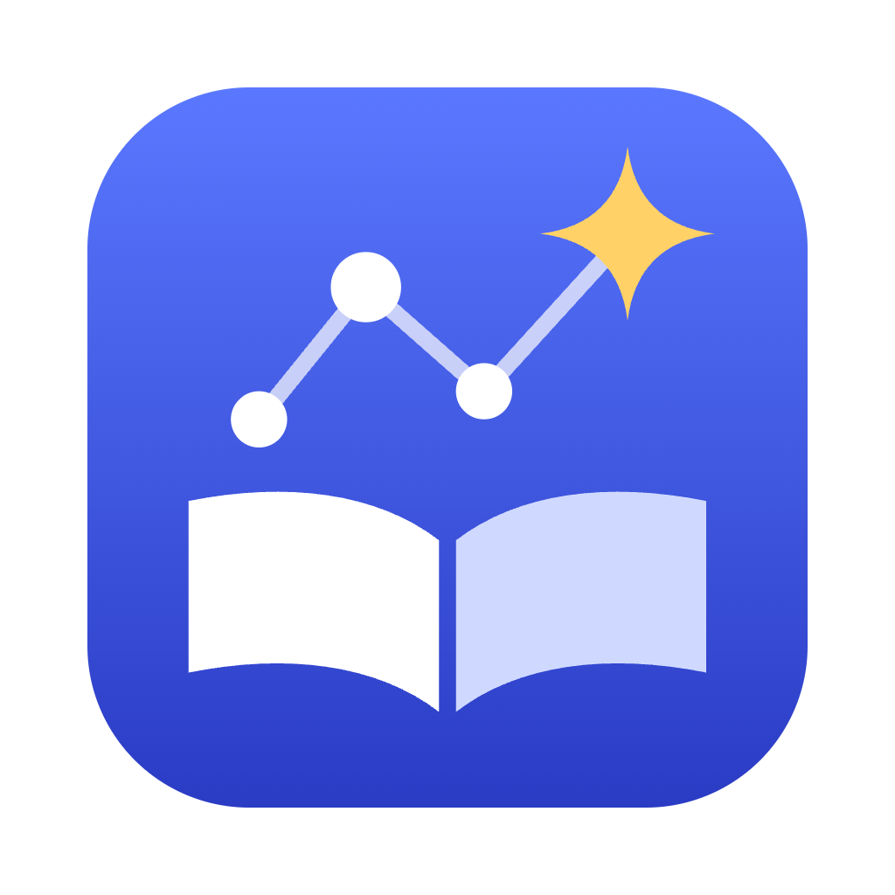
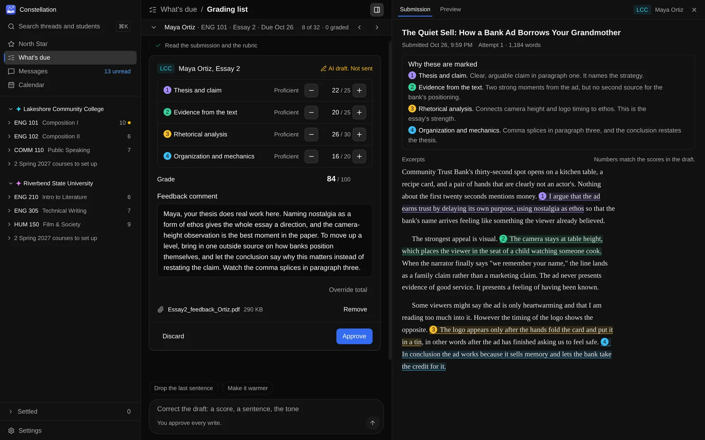

  

<h1 align="center">Constellation</h1>

Each school is a star in your academic journey.

  <a href="https://github.com/KyleCole90/constellation/releases"><strong>Download</strong></a> ·
  <a href="./PRIVACY.md">Privacy</a> ·
  <a href="./docs/keyboard-shortcuts.md">Shortcuts</a> ·
  <a href="./CONTRIBUTING.md">Contributing</a>

  

Constellation is a desktop app for adjunct instructors who teach at more than one school. Connect each school's Canvas, then run the whole week from one workspace: grading, messages, announcements, due dates, and next term's courses.

AI can draft the work. Nothing reaches Canvas until you read a plain preview of the change and approve it.

## What you get

- **North Star.** The home screen sits above every course. Ask it a question, and it answers, finds things, or hands the work to the right course thread.
- **Course threads.** Each task in a course is a thread: grade an assignment, answer a student, post an announcement.
- **What's due.** It lists what needs you next, across every school.
- **Grading list.** Move through submissions with `J` and `K`. Each draft shows the score, the rubric, and the feedback.
- **Every school in one place.** Each course has a gradebook and announcements. **Messages** and **Calendar** cover every school.
- **Start of term.** Copy a previous course or an `.imscc` export into a new one. Constellation shifts the dates to the new term and scans for stale content. It drafts fixes and checks the course before you publish it.
- **Approve, then send.** Every grade, comment, reply, and course edit waits on a preview of what will be sent. The AI cannot approve or send. If a send fails partway, the app reads Canvas before it tries again, so nothing is posted twice.

## Install

### Desktop app

[Download Constellation](https://github.com/KyleCole90/constellation/releases) for macOS. Each release has a `.dmg` for Apple silicon (`arm64`) and one for Intel. Both are signed and notarised. Every build so far is a pre-release.

### Connect your schools

On first run, type each school's Canvas address and paste a Canvas access token for it.

### Choose an AI source

Pick one in setup or in **Settings**:

- **Claude with your Anthropic API key.** The app encrypts the key with your Mac's Keychain and never shows it again.
- **Claude through your own Claude Code subscription.** The app runs the Claude Code installed on your Mac.
- **No AI.** You fill in grades and replies by hand.

## "Where does my data go?"

Constellation runs on your Mac. There is no Constellation server and no account. The app talks to your schools' Canvas with the tokens you paste. Student work goes only to the AI source you chose, and the app never switches to another one.

The installed app also sends usage events and scrubbed crash reports, with no text in them. Clear **Send usage data and crash reports** in setup or in **Settings** to stop them. [PRIVACY.md](./PRIVACY.md) lists everything the app sends and where.

## Documentation

- [Privacy](./PRIVACY.md)
- [Keyboard shortcuts](./docs/keyboard-shortcuts.md)
- [Decision records](./docs/adr/), for what the app guarantees and why

## Contributing

- Read [CONTRIBUTING.md](./CONTRIBUTING.md) to build from source and run the checks.
- [CLAUDE.md](./CLAUDE.md) lists the project's rules and the check that enforces each one.

## License

AGPL-3.0. See [LICENSE](./LICENSE).
